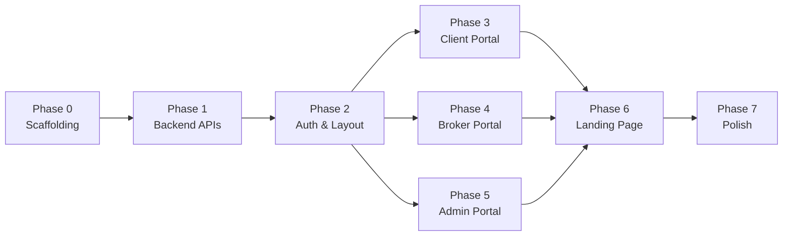

# EstateLink — Development Plan

> **Tech Stack**: Next.js 15 (App Router) · TypeScript · shadcn/ui · Tailwind CSS · MySQL · JWT Auth  
> **Database**: 9 BCNF-normalized tables (already designed — see `schema/schema.sql`)  
> **PRD Reference**: `docs/PRD.md`

---

## Architecture Overview

```
┌────────────────────────────────────────────────────────┐
│                    Next.js 15 App                      │
│  ┌──────────────┐  ┌──────────────┐  ┌──────────────┐ │
│  │  Landing Page │  │ Client Portal│  │ Admin Portal │ │
│  │  (Public)     │  │  (Auth)      │  │  (Auth)      │ │
│  └──────────────┘  └──────────────┘  └──────────────┘ │
│  ┌──────────────┐                                      │
│  │ Broker Portal│                                      │
│  │  (Auth)      │                                      │
│  └──────────────┘                                      │
│  ┌─────────────────────────────────────────────────┐   │
│  │            API Routes (/api/*)                   │   │
│  │  auth · properties · enquiries · deals ·        │   │
│  │  reviews · admin · brokers · clients            │   │
│  └──────────────────────┬──────────────────────────┘   │
└─────────────────────────┼──────────────────────────────┘
                          │
                    ┌─────▼─────┐
                    │  MySQL DB │
                    │ (mysql2)  │
                    └───────────┘
```

---

## Phase 0 — Project Scaffolding & Infrastructure

**Goal**: Get Next.js running with shadcn/ui, Tailwind, database connection, and auth utilities.

### Tasks

| # | Task | Details |
|---|------|---------|
| 0.1 | **Initialize Next.js 15 project** | `npx create-next-app@latest ./` with TypeScript, Tailwind CSS, App Router, `src/` directory |
| 0.2 | **Install & configure shadcn/ui** | `npx shadcn@latest init` — set up `components.json`, install base components (Button, Card, Input, Badge, Table, Dialog, Tabs, Avatar, DropdownMenu, Sheet, Separator, Skeleton, Toast, Select, Textarea) |
| 0.3 | **Install backend dependencies** | `mysql2` for database, `jsonwebtoken` + `bcryptjs` for auth, `jose` for edge-compatible JWT verification |
| 0.4 | **Database connection pool** | `src/lib/db.ts` — singleton MySQL connection pool using `mysql2/promise` reading from `.env.local` |
| 0.5 | **Auth utilities** | `src/lib/auth.ts` — JWT sign/verify, password hashing, middleware helper to extract user from cookies |
| 0.6 | **Global design tokens** | Configure Tailwind theme with EstateLink brand colors, typography (Inter/Outfit font), border radius tokens |
| 0.7 | **Root layout** | `src/app/layout.tsx` — global font loading, metadata, ThemeProvider, Toaster |
| 0.8 | **Environment setup** | `.env.local` with DB creds, JWT secret, `NEXT_PUBLIC_APP_URL` |

### Deliverables
- `npm run dev` boots without errors
- shadcn/ui components render correctly
- DB pool connects to `estatelink_db`
- Auth utility functions tested manually

---

## Phase 1 — Backend API Routes

**Goal**: Implement all REST API endpoints matching the PRD spec, with proper auth middleware and MySQL queries.

### 1A — Auth System

| # | Endpoint | Method | Access | Description |
|---|----------|--------|--------|-------------|
| 1.1 | `/api/auth/register` | POST | Public | Register user (broker/client). Inserts into `Brokers` or `Clients` table + a separate `Users` auth table |
| 1.2 | `/api/auth/login` | POST | Public | Validates credentials, returns JWT with `{ id, role, name, email }` claims in httpOnly cookie |
| 1.3 | `/api/auth/me` | GET | Authenticated | Returns current user profile from JWT |
| 1.4 | `/api/auth/logout` | POST | Authenticated | Clears auth cookie |

> **Auth design decision**: Since the DB schema doesn't have a `users` table with passwords, we'll add a lightweight `Users` table: `(user_id, email UNIQUE, password_hash, role ENUM('admin','broker','client'), ref_id INT)` where `ref_id` maps to `broker_id` or `client_id`. This is the **only schema addition** — everything else maps 1:1 to existing tables.

### 1B — Properties API

| # | Endpoint | Method | Access | Description |
|---|----------|--------|--------|-------------|
| 1.5 | `/api/properties` | GET | Public | List properties with filters: `location`, `min_budget`, `max_budget`, `bedrooms`, `tenant_type`, `status`, `broker_id`. Includes pagination. Joins with `Brokers`, `Commission`, `Leases`, `Property_Tenant_Type`. |
| 1.6 | `/api/properties/[id]` | GET | Public | Full property detail with broker info, commission, lease terms, tenant types, enquiry count |
| 1.7 | `/api/properties` | POST | Broker | Create property listing. Also creates `Commission` row, `Property_Tenant_Type` rows, and optionally `Leases` row (for rentals). Uses transaction. |
| 1.8 | `/api/properties/[id]` | PATCH | Broker/Admin | Update property details |

### 1C — Enquiries API

| # | Endpoint | Method | Access | Description |
|---|----------|--------|--------|-------------|
| 1.9 | `/api/enquiries` | POST | Client | Submit enquiry on a property. Auto-assigns `broker_id` from property. |
| 1.10 | `/api/enquiries` | GET | Broker/Client/Admin | Get enquiries. Brokers see their assigned ones; Clients see their own; Admin sees all. Supports `?status=` filter. |
| 1.11 | `/api/enquiries/[id]` | PATCH | Broker | Update enquiry status (`open` → `in_progress` → `closed`/`rejected`) |
| 1.12 | `/api/enquiries/[id]/convert` | POST | Broker | **Core business logic** — Convert enquiry to deal. Computes commission earnings via joins, creates `Deals` row, updates `Enquiries.status` and `Properties.status` in a transaction. |

### 1D — Deals API

| # | Endpoint | Method | Access | Description |
|---|----------|--------|--------|-------------|
| 1.13 | `/api/deals` | GET | Broker/Admin | Get deals filtered by `broker_id`, `deal_type`, `deal_status`. Admin sees all. |
| 1.14 | `/api/deals/[id]` | GET | Broker/Admin | Deal detail with computed earnings |

### 1E — Reviews API

| # | Endpoint | Method | Access | Description |
|---|----------|--------|--------|-------------|
| 1.15 | `/api/reviews` | POST | Client | Submit review for a completed deal (validates deal exists, client matches, no duplicate review) |
| 1.16 | `/api/reviews` | GET | Public | Get reviews, filterable by `broker_id` |

### 1F — Admin API

| # | Endpoint | Method | Access | Description |
|---|----------|--------|--------|-------------|
| 1.17 | `/api/admin/dashboard` | GET | Admin | Aggregate stats: total properties (by status), total deals (by type/status), total company earnings, total broker earnings, recent deals |
| 1.18 | `/api/admin/brokers/leaderboard` | GET | Admin | Uses `Broker_Leaderboard_View` — deals closed, earnings, average rating per broker |
| 1.19 | `/api/admin/refresh-rentals` | POST | Admin | Executes `sp_refresh_expired_rentals()` stored procedure |

### 1G — Supporting APIs

| # | Endpoint | Method | Access | Description |
|---|----------|--------|--------|-------------|
| 1.20 | `/api/brokers` | GET | Admin | List all brokers |
| 1.21 | `/api/clients` | GET | Admin | List all clients |
| 1.22 | `/api/brokers/[id]` | GET | Public | Broker profile with stats and reviews |

### Deliverables
- All endpoints return proper JSON responses
- Auth middleware protects role-gated routes
- Enquiry → Deal conversion works with correct commission calculation
- Rental refresh endpoint executes stored procedure

---

## Phase 2 — Frontend: Shared Layout & Auth Pages

**Goal**: Build the app shell — navigation, auth pages, role-based routing.

### Tasks

| # | Task | Details |
|---|------|---------|
| 2.1 | **Auth pages** | `/login` and `/register` — clean forms with shadcn Input, Select (for role), Button. Subtle gradient background. Form validation with error toasts. |
| 2.2 | **App shell / sidebar layout** | `src/app/(dashboard)/layout.tsx` — sidebar navigation using shadcn Sheet (mobile) + fixed sidebar (desktop). Links change based on user role. User avatar + dropdown in header. |
| 2.3 | **Auth context/hook** | `src/lib/hooks/useAuth.ts` — client-side auth state from `/api/auth/me`. Protected route wrapper component. |
| 2.4 | **Role-based route groups** | `(dashboard)/client/*`, `(dashboard)/broker/*`, `(dashboard)/admin/*` — redirect if wrong role |
| 2.5 | **Loading & error states** | Skeleton loaders using shadcn Skeleton. Error boundary with retry. |
| 2.6 | **Theme setup** | Dark mode by default, light mode toggle. Brand gradient accents (deep blue → emerald). |

### Deliverables
- Login/register flow works end-to-end
- Dashboard shell renders with role-appropriate navigation
- Protected routes redirect unauthenticated users

---

## Phase 3 — Frontend: Client Portal

**Goal**: Property browsing, filtering, enquiry submission, review posting.

### Pages

| # | Page | Route | Key Components |
|---|------|-------|---------------|
| 3.1 | **Property Listings** | `/properties` | Property cards grid (image placeholder, location, price, bedrooms, status badge). Filter sidebar/bar: location search, budget range, bedrooms, tenant type, sale/rental toggle. Pagination. |
| 3.2 | **Property Detail** | `/properties/[id]` | Hero section with property info. Stats pills (sqft, bedrooms, value). Broker card. Lease terms (if rental). Tenant eligibility badges. "Submit Enquiry" CTA button → dialog. |
| 3.3 | **Submit Enquiry** | Dialog on property detail | shadcn Dialog with Textarea for notes. Confirmation toast. |
| 3.4 | **My Enquiries** | `/client/enquiries` | Table of submitted enquiries with status badges (open=yellow, in_progress=blue, closed=green, rejected=red). Expandable rows with notes. |
| 3.5 | **Leave Review** | `/client/reviews/new?deal_id=` | Star rating component + comment textarea. Only accessible for completed deals. |

### Deliverables
- Client can browse, filter, view property details
- Client can submit enquiries and track status
- Client can leave reviews for completed deals

---

## Phase 4 — Frontend: Broker Portal

**Goal**: Broker dashboard, property listing form, enquiry management, deal conversion.

### Pages

| # | Page | Route | Key Components |
|---|------|-------|---------------|
| 4.1 | **Broker Dashboard** | `/broker/dashboard` | Overview stats cards (total enquiries, open, in progress, closed deals). Recent enquiries list. Quick actions. |
| 4.2 | **My Enquiries** | `/broker/enquiries` | Tabbed view by status (All / Open / In Progress / Closed / Rejected). Each row: client name, property, date, status badge, action buttons. |
| 4.3 | **Convert Enquiry to Deal** | `/broker/enquiries/[id]/convert` or Dialog | Form: deal type (sale/rental), deal value (pre-filled from property), rental dates (if applicable). Shows computed commission preview before confirming. |
| 4.4 | **List New Property** | `/broker/properties/new` | Multi-step form or single form: owner details, property details (location, sqft, bedrooms, value), commission rates, tenant types (multi-select), lease terms (conditional on rental). |
| 4.5 | **My Properties** | `/broker/properties` | Grid/table of properties managed by this broker with status badges. |
| 4.6 | **My Earnings** | `/broker/earnings` | Total earnings card. Deals table with per-deal earnings breakdown. |
| 4.7 | **My Reviews** | `/broker/reviews` | List of reviews with star ratings, client name, comments. Average rating display. |

### Deliverables
- Broker can list properties with commission and lease details
- Broker can manage enquiries pipeline
- Enquiry → Deal conversion with live commission preview
- Earnings and reviews dashboard

---

## Phase 5 — Frontend: Admin Portal

**Goal**: Company-wide dashboards, broker leaderboard, system management.

### Pages

| # | Page | Route | Key Components |
|---|------|-------|---------------|
| 5.1 | **Admin Dashboard** | `/admin/dashboard` | Stat cards: total properties (available/sold/rented), total deals, company earnings, broker earnings. Charts (optional): deals over time, revenue breakdown. |
| 5.2 | **Broker Leaderboard** | `/admin/brokers` | Table from `Broker_Leaderboard_View`: broker name, deals closed (sale/rental split), total deal volume, earnings, average rating. Sortable columns. |
| 5.3 | **Manage Properties** | `/admin/properties` | Full properties table with all statuses. Edit/view actions. |
| 5.4 | **Manage Enquiries** | `/admin/enquiries` | All enquiries across brokers. Filterable. |
| 5.5 | **Manage Deals** | `/admin/deals` | All deals with earnings columns. |
| 5.6 | **Refresh Rentals** | Action button on dashboard | "Refresh Expired Rentals" button that calls `POST /api/admin/refresh-rentals`. Shows count of updated records. Confirmation dialog. |
| 5.7 | **All Brokers/Clients** | `/admin/brokers`, `/admin/clients` | Simple data tables with shadcn Table. |

### Deliverables
- Admin has full visibility into all platform data
- Broker leaderboard renders from database view
- Rental refresh action works with confirmation

---

## Phase 6 — Landing Page

**Goal**: A polished, animated public landing page that sells EstateLink.

### Design Approach
- **Lightweight animations** — CSS animations + `IntersectionObserver` for scroll-triggered reveals. No heavy libraries (no GSAP/Framer Motion bundles).
- **Performance-first** — Lazy load sections, use CSS `will-change` sparingly, prefer `transform`/`opacity` animations for GPU compositing.

### Sections

| # | Section | Content | Animation |
|---|---------|---------|-----------|
| 6.1 | **Hero** | Big headline ("Brokerage, Simplified."), subtitle, CTA buttons (Browse Properties / Login). Gradient mesh background. | Fade-in + slide-up on load. Subtle floating particles or gradient shift (CSS only). |
| 6.2 | **Stats Bar** | "500+ Properties · 50 Brokers · ₹100Cr+ Deals Closed" | Count-up animation on scroll into view. |
| 6.3 | **Features** | 3-4 feature cards: Automated Commission, Rental Lifecycle, Smart Filtering, Verified Reviews | Staggered fade-in on scroll. Cards have subtle hover lift + shadow. |
| 6.4 | **How It Works** | 3-step flow: Browse → Enquire → Close Deal. Connected by a visual line/timeline. | Step-by-step reveal on scroll. |
| 6.5 | **Role Showcase** | Tabs or cards showing what each role (Client/Broker/Admin) gets. | Tab switch animation. Content slides. |
| 6.6 | **Testimonials** | Carousel of broker reviews from seed data. Star ratings. | Auto-scroll carousel, pause on hover. |
| 6.7 | **CTA Footer** | "Ready to modernize your brokerage?" + Sign up / Login buttons. | Gradient background pulse. |
| 6.8 | **Footer** | Links, copyright, team credits. | — |

### Performance Guardrails
- No animation library JS bundles — pure CSS `@keyframes` + `IntersectionObserver` (tiny custom hook)
- All images optimized via Next.js `<Image>` with lazy loading
- Animations use `transform` and `opacity` only (GPU-accelerated, no layout thrashing)
- `prefers-reduced-motion` media query respected

### Deliverables
- Visually impressive landing page
- Smooth scroll animations that don't lag
- Mobile-responsive
- Clear CTAs leading to auth/property browsing

---

## Phase 7 — Polish & Testing

**Goal**: Final refinements, edge cases, demo readiness.

### Tasks

| # | Task | Details |
|---|------|---------|
| 7.1 | **Responsive pass** | Test all pages on mobile/tablet/desktop breakpoints. Fix layout issues. |
| 7.2 | **Error handling** | Proper error messages for all API failures. Toast notifications. |
| 7.3 | **Empty states** | Friendly empty state illustrations/messages when no data exists. |
| 7.4 | **Loading states** | Skeleton screens on all data-fetching pages. |
| 7.5 | **Form validation** | Client-side validation on all forms. Server-side validation on all APIs. |
| 7.6 | **Demo seed data** | Ensure seed data demonstrates all flows: open enquiries, completed deals, expired rentals ready for refresh. |
| 7.7 | **End-to-end flow test** | Test: Register → Login → Browse → Enquire → Broker converts → Commission calculated → Client reviews → Admin sees leaderboard → Refresh rentals. |
| 7.8 | **Performance audit** | Lighthouse check on landing page. Ensure animations don't cause jank. |

---

## File Structure (Target)

```
src/
├── app/
│   ├── layout.tsx                    # Root layout (fonts, ThemeProvider, Toaster)
│   ├── page.tsx                      # Landing page
│   ├── globals.css                   # Tailwind + custom CSS animations
│   ├── (auth)/
│   │   ├── login/page.tsx
│   │   └── register/page.tsx
│   ├── (dashboard)/
│   │   ├── layout.tsx                # Dashboard shell (sidebar + header)
│   │   ├── properties/
│   │   │   ├── page.tsx              # Property listings (public/client)
│   │   │   └── [id]/page.tsx         # Property detail
│   │   ├── client/
│   │   │   ├── enquiries/page.tsx
│   │   │   └── reviews/
│   │   │       └── new/page.tsx
│   │   ├── broker/
│   │   │   ├── dashboard/page.tsx
│   │   │   ├── enquiries/page.tsx
│   │   │   ├── enquiries/[id]/convert/page.tsx
│   │   │   ├── properties/
│   │   │   │   ├── page.tsx
│   │   │   │   └── new/page.tsx
│   │   │   ├── earnings/page.tsx
│   │   │   └── reviews/page.tsx
│   │   └── admin/
│   │       ├── dashboard/page.tsx
│   │       ├── brokers/page.tsx
│   │       ├── clients/page.tsx
│   │       ├── properties/page.tsx
│   │       ├── enquiries/page.tsx
│   │       └── deals/page.tsx
│   └── api/
│       ├── auth/
│       │   ├── register/route.ts
│       │   ├── login/route.ts
│       │   ├── me/route.ts
│       │   └── logout/route.ts
│       ├── properties/
│       │   ├── route.ts              # GET (list) + POST (create)
│       │   └── [id]/route.ts         # GET (detail) + PATCH (update)
│       ├── enquiries/
│       │   ├── route.ts              # GET + POST
│       │   └── [id]/
│       │       ├── route.ts          # PATCH (update status)
│       │       └── convert/route.ts  # POST (enquiry → deal)
│       ├── deals/
│       │   ├── route.ts              # GET
│       │   └── [id]/route.ts         # GET
│       ├── reviews/
│       │   └── route.ts              # GET + POST
│       ├── brokers/
│       │   ├── route.ts              # GET (list)
│       │   └── [id]/route.ts         # GET (profile + stats)
│       ├── clients/
│       │   └── route.ts              # GET (list)
│       └── admin/
│           ├── dashboard/route.ts
│           ├── brokers/
│           │   └── leaderboard/route.ts
│           └── refresh-rentals/route.ts
├── components/
│   ├── ui/                           # shadcn/ui components (auto-generated)
│   ├── landing/                      # Landing page sections
│   │   ├── hero.tsx
│   │   ├── stats-bar.tsx
│   │   ├── features.tsx
│   │   ├── how-it-works.tsx
│   │   ├── role-showcase.tsx
│   │   ├── testimonials.tsx
│   │   └── cta-footer.tsx
│   ├── layout/
│   │   ├── sidebar.tsx
│   │   ├── header.tsx
│   │   └── nav-links.tsx
│   ├── properties/
│   │   ├── property-card.tsx
│   │   ├── property-filters.tsx
│   │   └── property-detail.tsx
│   ├── enquiries/
│   │   ├── enquiry-table.tsx
│   │   └── convert-deal-form.tsx
│   ├── dashboard/
│   │   ├── stat-card.tsx
│   │   └── leaderboard-table.tsx
│   └── shared/
│       ├── star-rating.tsx
│       ├── status-badge.tsx
│       ├── empty-state.tsx
│       └── page-header.tsx
└── lib/
    ├── db.ts                         # MySQL connection pool
    ├── auth.ts                       # JWT + password utilities
    ├── middleware.ts                  # Auth middleware for API routes
    ├── utils.ts                      # shadcn cn() utility + helpers
    └── hooks/
        ├── use-auth.ts               # Client-side auth hook
        └── use-scroll-animation.ts   # IntersectionObserver hook for landing page
```

---

## Database Addition: Users Table

The existing schema has `Brokers` and `Clients` but no auth table. We need a thin `Users` table to store login credentials:

```sql
CREATE TABLE Users (
    user_id    INT AUTO_INCREMENT PRIMARY KEY,
    email      VARCHAR(100) NOT NULL UNIQUE,
    password   VARCHAR(255) NOT NULL,          -- bcrypt hash
    role       ENUM('admin', 'broker', 'client') NOT NULL,
    ref_id     INT,                            -- broker_id or client_id
    created_at TIMESTAMP DEFAULT CURRENT_TIMESTAMP
);
```

This keeps the original 9-table schema intact while adding the minimal auth layer needed for the application.

---

## Execution Priority

The phases should be executed **sequentially** (each depends on the prior):



> **Phases 3, 4, 5** can be parallelized across team members once Phase 2 is done.

---

## Design Principles

1. **shadcn/ui everywhere** — No custom-styled inputs, buttons, or tables. Use shadcn components for consistency.
2. **Dark mode default** — Deep slate/zinc backgrounds with emerald/blue accent gradients.
3. **Micro-interactions** — Hover effects on cards, smooth page transitions, toast confirmations.
4. **Data density** — Admin/broker dashboards should feel data-rich but not cluttered. Use cards + tables together.
5. **Mobile-first** — Collapsible sidebar, stacked cards on mobile, touch-friendly buttons.
6. **Performance** — No heavy animation libraries. CSS-only where possible. Lazy load below-fold content.
